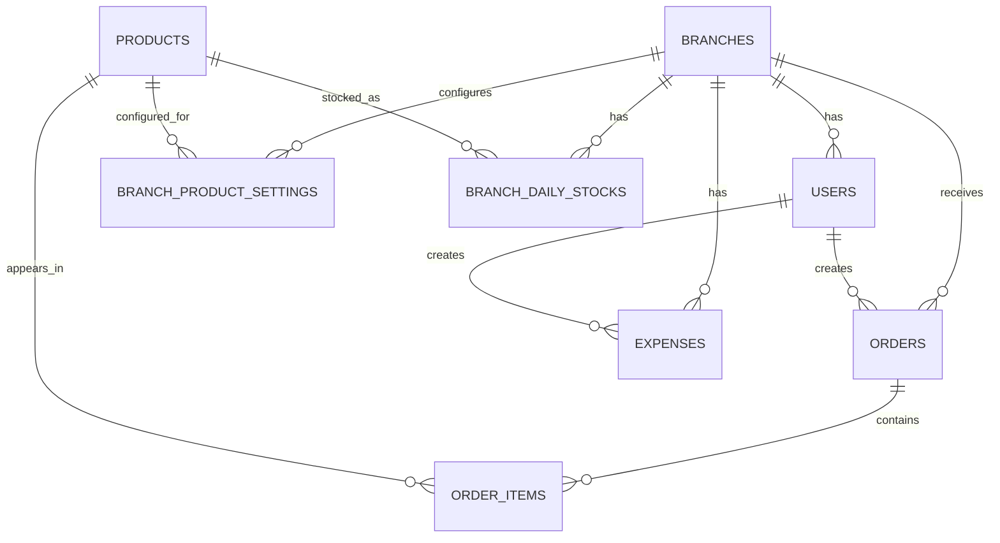

# BÁO CÁO THIẾT KẾ DATABASE - COFFEECHAIN

**Đồ án IT008 - Hệ thống quản lý chuỗi quán cà phê**  
**DBMS:** Microsoft SQL Server

---

## 1. Phạm vi đã chốt

- Hệ thống có hai vai trò: **Admin** và **Staff**.
- Một tài khoản Staff thuộc đúng **một chi nhánh**; Admin không thuộc chi nhánh cụ thể.
- Menu và giá hiện tại của sản phẩm dùng chung cho toàn bộ chi nhánh.
- Admin được sửa giá sản phẩm; đơn cũ phải giữ giá tại thời điểm tạo đơn.
- Mỗi chi nhánh có số lượng sản phẩm riêng theo từng ngày.
- Hàng chưa bán hết cuối ngày không chuyển sang ngày kế tiếp.
- Ngày kinh doanh mới bắt đầu lúc **00:00 theo giờ Việt Nam**.
- Staff được thêm, sửa và xóa chi phí của chi nhánh mình theo 4 loại: **điện, nước, mặt bằng, nhân viên**.
- Doanh thu được tính tự động từ các đơn có trạng thái `PAID`.
- `Branches` và `Products` dùng `IsActive`; `Expenses` được phép xóa cứng.

---

## 2. Mô hình dữ liệu tổng quát

Database gồm **8 bảng**:

1. `Branches`
2. `Users`
3. `Products`
4. `BranchProductSettings`
5. `BranchDailyStocks`
6. `Orders`
7. `OrderItems`
8. `Expenses`

Hai bảng `BranchProductSettings` và `BranchDailyStocks` được tách riêng vì:

- `BranchProductSettings` lưu số lượng mặc định do Admin cấu hình cho từng sản phẩm tại từng chi nhánh.
- `BranchDailyStocks` lưu số lượng thực tế của từng ngày.

### Sơ đồ quan hệ



---

## 3. Danh sách bảng

| Bảng | Mục đích |
|---|---|
| `Branches` | Thông tin chi nhánh và trạng thái hoạt động. |
| `Users` | Tài khoản Admin/Staff; Staff liên kết một Branch. |
| `Products` | Menu dùng chung và giá hiện tại. |
| `BranchProductSettings` | Số lượng mặc định theo Branch + Product. |
| `BranchDailyStocks` | Tồn thực tế theo Branch + Product + ngày. |
| `Orders` | Đơn hàng `PENDING` / `PAID` / `CANCELLED`. |
| `OrderItems` | Chi tiết món trong đơn và giá snapshot. |
| `Expenses` | Chi phí do Staff nhập cho chi nhánh. |

---

## 4. Data Dictionary

### 4.1. `Branches`

| Cột | Kiểu | Khóa / Ràng buộc | Ý nghĩa |
|---|---|---|---|
| `Id` | `INT IDENTITY` | PK | Mã chi nhánh. |
| `Name` | `NVARCHAR(120)` | NOT NULL | Tên chi nhánh. |
| `Address` | `NVARCHAR(255)` | NOT NULL | Địa chỉ. |
| `IsActive` | `BIT` | DEFAULT 1 | Hoạt động / ngừng hoạt động. |
| `CreatedAt` | `DATETIME2` | DEFAULT | Thời điểm tạo. |

### 4.2. `Users`

| Cột | Kiểu | Khóa / Ràng buộc | Ý nghĩa |
|---|---|---|---|
| `Id` | `INT IDENTITY` | PK | Mã tài khoản. |
| `Username` | `NVARCHAR(50)` | UNIQUE | Tên đăng nhập. |
| `PasswordHash` | `NVARCHAR(255)` | NOT NULL | Mật khẩu đã băm. |
| `Role` | `VARCHAR(10)` | `ADMIN` / `STAFF` | Vai trò. |
| `BranchId` | `INT NULL` | FK -> `Branches` | NULL cho Admin; bắt buộc với Staff. |
| `IsActive` | `BIT` | DEFAULT 1 | Cho phép đăng nhập. |
| `CreatedAt` | `DATETIME2` | DEFAULT | Thời điểm tạo. |

### 4.3. `Products`

| Cột | Kiểu | Khóa / Ràng buộc | Ý nghĩa |
|---|---|---|---|
| `Id` | `INT IDENTITY` | PK | Mã sản phẩm. |
| `Name` | `NVARCHAR(120)` | NOT NULL | Tên món. |
| `CurrentPrice` | `DECIMAL(18,2)` | `>= 0` | Giá hiện tại dùng chung toàn chuỗi. |
| `IsActive` | `BIT` | DEFAULT 1 | Đang bán / ngừng bán. |
| `CreatedAt` | `DATETIME2` | DEFAULT | Thời điểm tạo. |

### 4.4. `BranchProductSettings`

| Cột | Kiểu | Khóa / Ràng buộc | Ý nghĩa |
|---|---|---|---|
| `BranchId` | `INT` | PK, FK -> `Branches` | Chi nhánh. |
| `ProductId` | `INT` | PK, FK -> `Products` | Sản phẩm. |
| `DefaultDailyQuantity` | `INT` | `>= 0` | Số lượng mặc định đầu ngày do Admin nhập. |

### 4.5. `BranchDailyStocks`

| Cột | Kiểu | Khóa / Ràng buộc | Ý nghĩa |
|---|---|---|---|
| `BranchId` | `INT` | PK, FK -> `Branches` | Chi nhánh. |
| `ProductId` | `INT` | PK, FK -> `Products` | Sản phẩm. |
| `BusinessDate` | `DATE` | PK | Ngày kinh doanh theo giờ Việt Nam. |
| `OpeningQuantity` | `INT` | `>= 0` | Số lượng đầu ngày. |
| `RemainingQuantity` | `INT` | `0..OpeningQuantity` | Số lượng còn lại. |

### 4.6. `Orders`

| Cột | Kiểu | Khóa / Ràng buộc | Ý nghĩa |
|---|---|---|---|
| `Id` | `INT IDENTITY` | PK | Mã đơn. |
| `BranchId` | `INT` | FK -> `Branches` | Chi nhánh tạo đơn. |
| `StaffId` | `INT` | FK -> `Users` | Staff tạo đơn. |
| `Status` | `VARCHAR(12)` | `PENDING` / `PAID` / `CANCELLED` | Trạng thái đơn. |
| `TotalAmount` | `DECIMAL(18,2)` | `>= 0` | Tổng tiền snapshot. |
| `CreatedAt` | `DATETIME2` | DEFAULT | Thời điểm tạo. |
| `PaidAt` | `DATETIME2 NULL` |  | Thời điểm thanh toán. |
| `ExpiresAt` | `DATETIME2 NULL` | Optional | Hỗ trợ dọn các đơn `PENDING` cũ. |

### 4.7. `OrderItems`

| Cột | Kiểu | Khóa / Ràng buộc | Ý nghĩa |
|---|---|---|---|
| `Id` | `INT IDENTITY` | PK | Mã dòng đơn. |
| `OrderId` | `INT` | FK -> `Orders` | Đơn hàng. |
| `ProductId` | `INT` | FK -> `Products` | Sản phẩm. |
| `Quantity` | `INT` | `> 0` | Số lượng. |
| `UnitPrice` | `DECIMAL(18,2)` | `>= 0` | Giá tại thời điểm tạo đơn. |

### 4.8. `Expenses`

| Cột | Kiểu | Khóa / Ràng buộc | Ý nghĩa |
|---|---|---|---|
| `Id` | `INT IDENTITY` | PK | Mã khoản chi. |
| `BranchId` | `INT` | FK -> `Branches` | Chi nhánh. |
| `StaffId` | `INT` | FK -> `Users` | Staff nhập chi phí. |
| `Category` | `VARCHAR(20)` | 4 giá trị cố định | `ELECTRICITY`, `WATER`, `RENT`, `STAFF`. |
| `Amount` | `DECIMAL(18,2)` | `> 0` | Số tiền. |
| `ExpenseDate` | `DATE` | NOT NULL | Ngày phát sinh. |
| `Note` | `NVARCHAR(255) NULL` |  | Ghi chú. |
| `CreatedAt` | `DATETIME2` | DEFAULT | Thời điểm tạo. |
| `UpdatedAt` | `DATETIME2 NULL` |  | Lần sửa gần nhất. |

---

## 5. Quan hệ giữa các bảng

- `Branches 1 - N Users`.
- `Branches N - N Products` thông qua `BranchProductSettings`.
- `Branches N - N Products` theo từng ngày thông qua `BranchDailyStocks`.
- `Branches 1 - N Orders` và `Users 1 - N Orders`.
- `Orders 1 - N OrderItems`.
- `Products 1 - N OrderItems`.
- `Branches 1 - N Expenses` và `Users 1 - N Expenses`.

---

## 6. Tồn hàng theo ngày

Admin cấu hình `DefaultDailyQuantity` cho từng cặp **Branch - Product**.

Khi Staff mở menu trong một ngày mới, ứng dụng kiểm tra `BranchDailyStocks` của `BusinessDate` hiện tại. Nếu chưa có dữ liệu thì tạo bản ghi mới với:

```text
OpeningQuantity   = DefaultDailyQuantity
RemainingQuantity = DefaultDailyQuantity
```

Khi đơn chuyển sang `PAID`, `RemainingQuantity` giảm theo số lượng bán. Đơn `CANCELLED` không làm giảm tồn.

Sang **00:00 giờ Việt Nam**, ứng dụng chuyển sang `BusinessDate` mới; lượng dư ngày trước bị bỏ và **không carry-over**.

Không cần dùng SQL Server Agent chạy đúng lúc 00:00. App chỉ cần tạo `BranchDailyStocks` của ngày hiện tại khi chưa tồn tại.

---

## 7. Đơn hàng và giá lịch sử

`Products.CurrentPrice` là giá hiện tại.

Khi tạo đơn, giá sản phẩm được chụp vào:

```text
OrderItems.UnitPrice
```

Vì vậy, nếu Admin thay đổi giá sản phẩm sau đó thì đơn cũ vẫn giữ giá lúc bán.

`Orders.TotalAmount` được tính từ:

```text
SUM(OrderItems.Quantity * OrderItems.UnitPrice)
```

Chỉ đơn có `Status = 'PAID'` được dùng để tính doanh thu.

---

## 8. Chi phí, doanh thu và lợi nhuận

Staff được thêm, sửa và xóa cứng `Expenses` của chi nhánh mình.

Các loại chi phí hiện tại:

- `ELECTRICITY` - tiền điện.
- `WATER` - tiền nước.
- `RENT` - tiền mặt bằng.
- `STAFF` - chi phí nhân viên.

### Doanh thu

```text
Revenue = SUM(Orders.TotalAmount)
          với Orders.Status = 'PAID'
```

### Chi phí

```text
Expense = SUM(Expenses.Amount)
```

### Lợi nhuận

```text
Profit = Revenue - Expense
```

Không tạo bảng `Revenue` riêng vì doanh thu có thể tính trực tiếp từ các đơn đã thanh toán.

---

## 9. Xóa dữ liệu

- `Branches` và `Products` không xóa vật lý; sử dụng `IsActive = 0` để giữ lịch sử đơn hàng.
- `Expenses` được phép `DELETE` trực tiếp theo scope hiện tại.
- Các đơn `PENDING` cũ có thể được ứng dụng xóa dựa vào `ExpiresAt` nếu nhóm dùng chức năng timeout.

---

## 10. Phân chia trách nhiệm Database / Application

### Database

Database chịu trách nhiệm:

- Primary Key.
- Foreign Key.
- `UNIQUE`.
- `CHECK` constraint.
- Lưu trữ dữ liệu.

### Application

Application chịu trách nhiệm:

- Kiểm tra Staff chỉ thao tác dữ liệu của `BranchId` đang đăng nhập.
- Xác định `BusinessDate` theo giờ Việt Nam.
- Tạo `BranchDailyStocks` của ngày mới từ `BranchProductSettings`.
- Dùng transaction khi chuyển Order sang `PAID` và trừ `RemainingQuantity`.
- Cập nhật `Orders.TotalAmount`.
- Cập nhật `Expenses.UpdatedAt` khi chỉnh sửa chi phí.

---

## 11. Index chính

Database có các index phục vụ các hướng truy vấn thường dùng:

- `Users.BranchId`.
- `Orders(BranchId, Status, PaidAt)`.
- `Orders.StaffId`.
- `BranchDailyStocks(BranchId, BusinessDate)`.
- `OrderItems.OrderId`.
- `OrderItems.ProductId`.
- `Expenses(BranchId, ExpenseDate)`.
- `Expenses.StaffId`.

Các index này giúp truy vấn theo chi nhánh, ngày, trạng thái đơn và Staff nhanh hơn khi dữ liệu tăng lên.

---

## 12. Phạm vi chưa đưa vào database

- Rating / số sao chi nhánh: tạm bỏ.
- Khách hàng, loyalty, giao hàng và thanh toán thật: ngoài phạm vi.
- `InventoryMovements` / lịch sử điều chỉnh kho: chưa thêm để giữ đồ án gọn.
- Trigger, stored procedure và SQL Server Agent: không bắt buộc.

---

## 13. Cách chạy file SQL

1. Mở **SQL Server Management Studio (SSMS)**.
2. Kết nối tới SQL Server.
3. Mở file `CoffeeChain_Database.sql`.
4. Chọn **Execute**.

Script sẽ tạo database `CoffeeChainDb` nếu chưa tồn tại, sau đó tạo 8 bảng, các khóa/ràng buộc và index.

> Script được thiết kế cho database mới. Không nên chạy lại toàn bộ script trên database đã có các bảng cùng tên.

---

